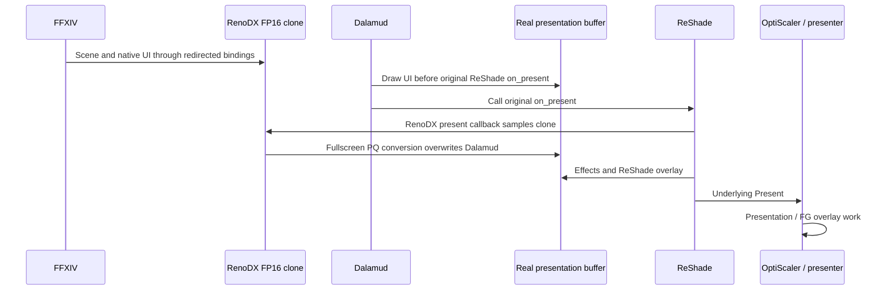

# FFXIV HDR10 presentation: invisible Dalamud UI investigation

Investigation date: 2026-09-26  
Branch: `feature/hdr10`  
Investigated HEAD: `f75a147de9c4488a8774c0a08e4dbddc74060797`

This report records a read-only investigation. No source changes, settings changes, builds, deployments, or fixes were performed. This report was subsequently saved at the user's request.

## Conclusion

**The most likely cause is Stage 2's switch to redirected FP16 rendering: Dalamud draws into the real backbuffer, then RenoDX overwrites it with the FP16 proxy's contents.** Dalamud's pixels never enter the image used by the final HDR10 conversion.

For the Dalamud configuration found on this machine, the evidence points to **rendering before RenoDX's conversion and being overwritten**, rather than rendering into the proxy after conversion.

The evidence is strong, with one runtime limit: the saved ReShade log describes an scRGB run, so it is not a GPU capture of the failing HDR10 frame. This diagnosis is based on source, configuration, and logs. A capture of the failing frame should confirm the actual resource pointers and contents.

## Revision comparison

| Version | Game rendering destination | RenoDX's final-pass input | Consequence for Dalamud's direct backbuffer drawing |
|---|---|---|---|
| Original, `9b212eda` | Real FP16 backbuffer | Copy of that real backbuffer | Included in final conversion |
| Stage 1, `a9fc687b` | Real FP16 backbuffer | Real backbuffer copied into a temporary clone at Present | Still included |
| Stage 2, `f75a147d` | Redirected FP16 clone | Existing FP16 clone, without copying the real backbuffer | Direct backbuffer pixels are overwritten |

Stage 1 is commit `a9fc687b50b2bb4d4cb4c1efc4e2ae77384348f8`, `[mod:ffxiv] Use shared swapchain proxy while retaining scRGB`. It changes only `src/games/ffxiv/addon.cpp`.

Stage 2 is commit `f75a147de9c4488a8774c0a08e4dbddc74060797`, `[mod:ffxiv] Add HDR10/PQ presentation support`. It changes `addon.cpp` and `final_pixel_shader.ps_5_0.hlsl`.

The relevant history can be reviewed without changing the checkout:

```powershell
git diff 9b212eda a9fc687b -- src/games/ffxiv
git diff a9fc687b f75a147d -- src/games/ffxiv
git show 9b212eda:src/games/ffxiv/addon.cpp
```

## Original presentation path

The original FFXIV `OnPresent` obtained `get_current_back_buffer()`, copied it into `DeviceData::final_texture`, then rendered a fullscreen triangle back into that backbuffer. Its shader decoded the gamma-space RGB and scaled it by `toneMapUINits / 80` for scRGB.

Because FFXIV and Dalamud both contributed to that real FP16 backbuffer before the copy, the conversion included both.

## Stage 1: shared proxy with compatibility mode

Stage 1 deleted the custom pipeline/resource management and configured the shared proxy with:

```cpp
target_format = r16g16b16a16_float;
swap_chain_proxy_format = r16g16b16a16_float;
swapchain_proxy_compatibility_mode = true;
```

`UsingSwapchainCompatibilityMode()` requires both the flag and matching formats. In this mode:

- Swapchain resource redirection is disabled through `clone_enabled`.
- `SwapchainProxyPass::Render()` copies the real backbuffer into the clone immediately before conversion.
- The original scRGB pixel shader remains unchanged.

Stage 1 also keeps the FFXIV copy-tracker reset after the proxy pass. There is no evidence that moving that reset caused the missing overlay.

Relevant source:

- [Shared swapchain module selection](src/mods/swapchain.hpp): defaults to version 2.
- [Shared swapchain implementation](src/mods/swapchain_v2.hpp): `UsingSwapchainCompatibilityMode()`, around line 213.
- [Proxy rendering](src/utils/draw.hpp): compatibility branch of `SwapchainProxyPass::Render()`, around line 137.

## Stage 2: separate FP16 rendering and RGB10A2/PQ output

Stage 2 calls `SetUseHDR10()`, selecting RGB10A2 and ST2084, and disables compatibility mode. The game-facing rendering path therefore uses a separate FP16 clone.

`OnInitSwapchain()` marks the backbuffer with:

```cpp
info->clone_target = &data->swap_chain_clone_info;
info->clone_enabled = ... || !UsingSwapchainCompatibilityMode();
info->clone_can_deactivate = false;
```

RenoDX redirects intercepted render-target bindings through `OnBindRenderTargetsAndDepthStencil()`, `RewriteRenderTargets()`, and `GetResourceViewClone()`.

At Present, the noncompatibility branch of `SwapchainProxyPass::Render()` selects the **existing clone**. It does not first incorporate the real backbuffer. It samples that clone and writes the real backbuffer with a fullscreen, nonblended draw.

The final FFXIV shader converts the preserved gamma-space BT.709 signal into BT.2020/PQ. It has only that source texture; it cannot preserve an overlay present exclusively in the destination.

The shared pass requests a discard load operation, but the decisive operation on D3D11 is the fullscreen overwrite with blending disabled. Merely changing the load operation would not preserve Dalamud.

Relevant source:

- [FFXIV addon](src/games/ffxiv/addon.cpp): configuration and callback registration, around line 305.
- [Shared swapchain implementation](src/mods/swapchain_v2.hpp): `SetUseHDR10()` around line 389; backbuffer clone setup around line 899; proxy Present callback around line 1231.
- [Resource redirection](src/utils/resource_upgrade.hpp): `ApplyRenderTargetClones()` around line 733; `RewriteRenderTargets()` around line 819; `OnBindRenderTargetsAndDepthStencil()` around line 3260.
- [Proxy rendering](src/utils/draw.hpp): existing-clone selection and real-backbuffer output.
- [Final output shader](src/games/ffxiv/final_pixel_shader.ps_5_0.hlsl).

## Dalamud's rendering path

The installed Dalamud release is **15.0.3.5**. The local configuration contains:

```json
"ReShadeHandlingModeV2": 4,
"SwapChainHookMode": 0
```

The local log explicitly confirms that Dalamud found and hooked ReShade's `DXGISwapChain::on_present` using bytecode.

Local evidence locations:

- `C:/Users/kuris/AppData/Roaming/XIVLauncher/dalamudConfig.json`, around lines 3894–3895.
- `C:/Users/kuris/AppData/Roaming/XIVLauncher/dalamud.log`, release identification at line 3 and hook identification around lines 113–116.
- `H:/Games/FFXIV/game/ReShade.log`, scRGB format selection around lines 105–120. This log is not a capture of the failing HDR10 run.

In Dalamud 15.0.3.5, its ReShade detour calls `RenderDalamudDraw()` **before** invoking ReShade's original `on_present`. This fixes its position relative to RenoDX's addon callback; addon registration ordering cannot move RenoDX ahead of that detour.

Source: [installed-release hook implementation](https://github.com/goatcorp/Dalamud/blob/15.0.3.5/Dalamud/Interface/Internal/InterfaceManager.AsHook.cs#L77).

Separately, Dalamud's D3D11 backend:

1. Calls `ReShadePeeler.PeelSwapChain()`.
2. Obtains the device from the peeled swapchain.
3. Obtains that device's immediate context.
4. Creates its render target from the peeled swapchain's `GetBuffer(0)`.

Its render-target creation uses that device directly. Consequently, its rendering bypasses the ReShade wrapper callbacks RenoDX uses for clone redirection.

Sources: [backend initialization](https://github.com/goatcorp/Dalamud/blob/15.0.3.5/Dalamud/Interface/ImGuiBackend/Dx11Win32Backend.cs#L41), [backbuffer RTV creation](https://github.com/goatcorp/Dalamud/blob/15.0.3.5/Dalamud/Interface/ImGuiBackend/Renderers/Dx11Renderer.ViewportHandler.cs#L336), [ReShade peeling implementation](https://github.com/goatcorp/Dalamud/blob/15.0.3.5/Dalamud/Interface/ImGuiBackend/Helpers/ReShadePeeler.cs).

“Real backbuffer” here means the surface exposed underneath ReShade. With OptiScaler frame generation enabled, that may itself be an OptiScaler-managed D3D11 presentation surface. The essential distinction is that **it is not RenoDX's FP16 clone**.

## Callback and presentation ordering



The concrete ordering is:

1. `DXGISwapChain::Present()` calls `on_present()`.
2. Dalamud's detour executes first.
3. Original `on_present()` emits D3D11 `execute_command_list`, then addon `present`.
4. RenoDX's shared `OnPresent()` runs `SwapchainProxyPass::Render()`.
5. FFXIV's local `OnPresent()` resets copy tracking.
6. ReShade runs its effect runtime and GUI.
7. The swapchain wrapper calls the underlying Present.

Relevant source:

- [ReShade DXGI presentation](external/reshade/source/dxgi/dxgi_swapchain.cpp): D3D11 event ordering around line 982.
- [ReShade runtime](external/reshade/source/runtime.cpp): effect rendering and GUI around lines 631–657; `reshade_present` around line 830.
- [ReShade GUI](external/reshade/source/runtime_gui.cpp): `reshade_overlay` around line 1431; GUI rendering around line 1500.
- [RenoDX proxy callback](src/mods/swapchain_v2.hpp): around line 1231.
- [FFXIV registration order](src/games/ffxiv/addon.cpp): around line 305.

The inspected ReShade submodule revision was `4a50d1eddace85734871d91792ff214f13f66c01`. The local runtime log identifies ReShade `6.8.0.2155`; the loaded binary's exact correspondence to that source revision was not independently established.

## Why the other overlays remain visible

| Renderer | Why its pixels survive—or disappear |
|---|---|
| FFXIV's native UI | Uses the intercepted game rendering path and is included in the FP16 clone. |
| Dalamud | Draws through its peeled device/context into the presentation buffer before RenoDX replaces that buffer. |
| ReShade overlay | Renders after RenoDX's addon Present callback, through ReShade's internal command implementation. |
| OptiScaler overlay | Its presentation/FG overlay work occurs downstream in the relevant wrapper path, after the RenoDX image is produced. |

ReShade's internal D3D11 command implementation binds through `_orig->OMSetRenderTargets`, rather than re-entering the application wrapper's clone-redirection callback. Its GUI therefore reaches the actual output target. See [internal binding implementation](external/reshade/source/d3d11/d3d11_impl_command_list.cpp), around line 202.

OptiScaler's source places `MenuOverlayDx::Present()` in its presentation path, including the DX11-to-DX12/FG path. The saved OptiScaler log also records the D3D12 overlay path. Exact nesting remains dependent on the installed OptiScaler build and FG mode. See [OptiScaler presentation implementation](https://github.com/optiscaler/OptiScaler/blob/44cfee4d436857742a9bf71bbe81396ec9989715/OptiScaler/with_dx12/dx11_with_dx12_sc.cpp#L358).

Incorrect brightness under PQ is a separate color-space/blending issue. It does not explain complete disappearance as well as the destination overwrite does. Dalamud's input handling remains functional because building and interacting with ImGui windows does not depend on their GPU output surviving presentation.

## Stage attribution

**The regression belongs to Stage 2's use of the shared proxy, not to PQ mathematics itself.**

Stage 1 alone retains the copy-before-conversion behavior that preserves this overlay. Stage 1 is therefore expected to pass the Dalamud visibility test, although that isolated runtime test still needs doing.

Conversely, an scRGB configuration using **noncompatibility proxy redirection** could exhibit the same failure. HDR10 is not intrinsically required; the relevant condition is separating the game's authoritative render surface from the surface Dalamud draws into.

Simply setting `swapchain_proxy_compatibility_mode = true` in the HDR10 build would not restore compatibility mode. RGB10A2 and FP16 still fail the format-equality condition.

## Existing RenoDX mechanisms

| Existing pattern | Examples | Applicability |
|---|---|---|
| HDR10 output from an FP16 proxy | [Fallout 76](src/games/fallout76/addon.cpp), [Batman Arkham Knight](src/games/batmanak/addon.cpp), [Starfield](src/games/starfield/addon.cpp) | Establishes the output architecture, but does not automatically preserve external writes to the real buffer. |
| Swapchain compatibility mode | [Unreal Engine](src/games/unrealengine/addon.cpp), [Wuthering Waves](src/games/wutheringwaves/addon.cpp), [Dragon Age: Inquisition](src/games/dai/addon.cpp) | Explicitly intended to improve third-party swapchain compatibility; requires matching formats. |
| `swapchain_proxy_revert_state` | [Trackmania](src/games/trackmania/addon.cpp), [Descenders](src/games/descenders/addon.cpp), and others | Restores graphics bindings/state. It cannot restore overwritten image contents. |

No established shared mechanism was found in this checkout that automatically merges arbitrary third-party overlay pixels from the real backbuffer into an HDR10 proxy output. These examples are not evidence that such overlays are already handled.

## Smallest recommended fix to validate

**Validate Dalamud's supported `ReShadeAddonReShadeOverlay` mode.**

That corresponds to mode **3** in the installed release. It schedules Dalamud drawing at ReShade's `reshade_overlay` event, after RenoDX's conversion and ReShade's effects. It avoids depending on registration order within the earlier addon `present` event. See [Dalamud's callback implementation](https://github.com/goatcorp/Dalamud/blob/15.0.3.5/Dalamud/Interface/Internal/InterfaceManager.AsReShadeAddon.cs#L49).

This is a configuration compatibility fix, not a RenoDX source patch. **It has not been applied or runtime-validated.**

It should resolve the missing pixels, but it does not automatically make Dalamud's colors and translucent blending correct in PQ. A complete color-correct integration would instead route Dalamud into the FP16 composition before conversion, or composite a separate SDR UI layer with explicit color conversion.

If the requirement is a **RenoDX-only fix with the current Dalamud mode unchanged**, there is no justified one-line fix in the traced code. The presentation conversion would need a verified boundary before Dalamud draws, or explicit cooperation with its render-target path. Moving conversion to a later ReShade callback would still overwrite Dalamud and could additionally overwrite ReShade's overlay.

Restoring state, blindly alpha-blending the real backbuffer, or copying RGB10A2 into the FP16 working image are not substitutes. None recovers the missing composition correctly.

## Risks

| Area | Expected effect / risk of the recommended scheduling change |
|---|---|
| HDR10 and normal FFXIV rendering | Low direct risk: the existing scene conversion, formats and color-space selection remain intact. |
| Dalamud appearance | Visibility should return; PQ brightness, transparency and background blur may remain incorrect. |
| ReShade | Dalamud would render after effects, changing which effects influence its UI. Overlay stacking and input need checking. |
| OptiScaler / DLSS Neural Rendering | No planned change to their inputs or HDR10 format; verify the actual wrapper chain. |
| DLSSG / XeFG | The UI's inclusion in generated-frame inputs and any HUD separation depends on where the presentation handoff occurs. Test both independently. |
| Resize and secondary windows | Validate RTV recreation, fullscreen transitions and detached Dalamud viewports. |

## Proposed validation plan

1. **Run the three existing revisions with identical configuration:** original `9b212eda`, Stage 1 `a9fc687b`, and Stage 2 `f75a147d`. Expected visibility: visible, visible, invisible. Record matching logs and addon identity for each run.

2. **Capture one failing frame at the native D3D11 level.** Identify RenoDX's real backbuffer and FP16 clone, Dalamud's RTV and owning resource, image contents immediately after Dalamud draws, and image contents immediately after RenoDX's fullscreen conversion. The predicted result is Dalamud present in the real buffer before conversion, absent from the clone, and erased after conversion. A ReShade/DevKit-only draw trace may miss Dalamud because it deliberately bypasses ReShade's wrappers.

3. **Test the supported overlay callback mode on Stage 2.** Confirm registration succeeds and that Dalamud appears with ReShade's menu both open and closed. ReShade dispatches this callback even when its own menu is closed.

4. **Exercise the rendering matrix:** FG off, XeFG, DLSSG, and DLSS Neural Rendering as applicable. Check UI visibility, generated-frame stability, motion ghosting, frame pacing, and overlay layering.

5. **Check image correctness separately:** opaque and translucent Dalamud windows, text, tooltips, blur, native FFXIV UI, scene highlights and UI brightness settings. Verify RGB10A2/ST2084 remains active.

6. **Check lifecycle behavior:** resize, minimize/restore, alt-tab, display-mode changes and detached viewports.

The decisive test is the resource capture in step 2. It will distinguish the overwrite mechanism from a wrong-buffer-index issue or an unexpected wrapper arrangement without guessing at a fix.
